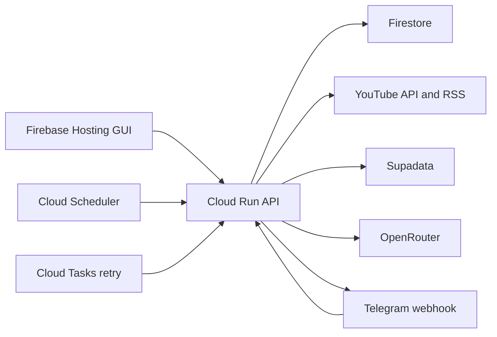

# YouTube Channel Intelligence

Serverless YouTube monitoring and AI analysis on Google Cloud.

The application watches selected YouTube channels, retrieves captions through
Supadata, analyzes new videos through OpenRouter, and delivers formatted reports
to Telegram subscribers.

## Features

- Firebase Hosting control panel with password authentication.
- Add channels by name, `@handle`, channel ID, or URL.
- Analyze the latest video immediately when a channel is added.
- Poll active channel RSS feeds every three hours.
- Retry unavailable captions through Cloud Tasks after two hours.
- Select a global OpenRouter model and analysis prompt from the GUI.
- Deliver reports to the administrator and password-authorized subscribers.
- Display Telegram usernames in the admin dashboard.
- Scale the Cloud Run backend to zero while idle.
- Store all credentials in Google Secret Manager.

## Processing Flow



1. Adding a channel resolves its canonical YouTube channel ID.
2. Its latest upload is processed immediately.
3. Cloud Scheduler invokes the polling endpoint every three hours.
4. The backend compares the RSS feed with the last processed video.
5. Supadata retrieves native captions.
6. Missing captions are retried two hours later.
7. OpenRouter generates one analysis using the global model and prompt.
8. Telegram sends the report to every active subscriber.

Processing is idempotent per channel and video, so scheduled polls do not
intentionally resend completed reports.

## Architecture

- **Frontend:** React, TypeScript, Vite, Firebase Hosting.
- **Backend:** Node.js 22, TypeScript, Express, Docker, Cloud Run.
- **Database:** Firestore Native mode.
- **Scheduling:** Cloud Scheduler with OIDC authentication.
- **Retries:** Cloud Tasks with OIDC authentication.
- **Channel discovery:** YouTube Data API and YouTube RSS.
- **Captions:** Supadata native caption mode.
- **AI:** OpenRouter.
- **Delivery:** Telegram Bot API webhook and messages.
- **Secrets:** Google Secret Manager.

The Cloud Run service exposes:

- `/api/*` for authenticated dashboard operations.
- `/internal/poll` for Cloud Scheduler.
- `/internal/retry` for Cloud Tasks.
- `/telegram/webhook` for Telegram subscriptions.
- `/health` for service health checks.

## Telegram Subscriptions

Subscribers message the bot:

```text
/subscribe SUBSCRIBER_PASSWORD
```

The bot replies with the active channel names. Subscribers receive only analyses
created after they subscribe; historical reports are not replayed.

To stop reports:

```text
/unsubscribe
```

The subscriber password must be different from the dashboard administrator
password.

## OpenRouter Models

The default allowlist is:

- `anthropic/claude-sonnet-4.6`
- `google/gemini-3.5-flash`
- `openai/gpt-chat-latest`

Override it with `OPENROUTER_MODEL_ALLOWLIST`.

## Local Development

Requirements:

- Node.js 22+
- Google Cloud CLI
- Firebase CLI
- Application Default Credentials with Firestore access

```bash
npm install
cp backend/.env.example backend/.env
cp frontend/.env.example frontend/.env.local
gcloud auth application-default login
```

Set development values in `backend/.env`. Never commit this file.

```bash
npm run dev:backend
npm run dev:frontend
```

Useful validation commands:

```bash
npm run build
npm run typecheck
npm test
```

## Google Cloud Deployment

The included scripts default to:

- Project: `didiberman`
- Region: `europe-west1`
- Cloud Run service: `youtube-channel-intelligence`

Bootstrap APIs, service accounts, Artifact Registry, and the retry queue:

```bash
./scripts/bootstrap-gcp.sh
```

Create these Secret Manager secrets using your own values:

```text
youtube-api-key
supadata-api-key
telegram-bot-token
telegram-webhook-secret
telegram-subscribe-password
openrouter-api-key
admin-password
scheduler-audience
```

Example secret creation pattern:

```bash
printf '%s' 'REPLACE_WITH_SECRET' |
  gcloud secrets create SECRET_NAME --data-file=-
```

Deploy the backend:

```bash
gcloud builds submit --config cloudbuild.yaml
```

Update `scheduler-audience` with the exact deployed Cloud Run URL, then create
the scheduler:

```bash
SERVICE_URL="$(gcloud run services describe youtube-channel-intelligence \
  --region=europe-west1 --format='value(status.url)')"
printf '%s' "${SERVICE_URL}" |
  gcloud secrets versions add scheduler-audience --data-file=-
./scripts/create-scheduler.sh
```

Build and deploy Firebase:

```bash
npm run build
firebase deploy --only hosting,firestore
```

Register the Telegram webhook at:

```text
https://YOUR_CLOUD_RUN_SERVICE/telegram/webhook
```

Pass the `telegram-webhook-secret` value as Telegram's `secret_token`.

## Firestore Layout

```text
channels/{channelId}
channels/{channelId}/videos/{videoId}
settings/global
telegramSubscribers/{chatId}
```

Browser access is denied by `firestore.rules`; application data is accessed
through the authenticated backend.

## Security

- Secrets are injected into Cloud Run from Secret Manager.
- `.env` files, build output, logs, and local Firebase data are gitignored.
- Scheduler and retry endpoints verify Google-issued OIDC tokens.
- Telegram webhook requests verify Telegram's secret-token header.
- The subscriber password is separate from the dashboard password.
- A failed subscriber delivery does not prevent delivery to other subscribers.

Before publishing a fork, run a secret scanner and inspect `git diff --cached`.

## Operational Notes

- Prefer channel IDs, `@handles`, or canonical URLs to conserve YouTube search
  quota.
- The backend uses a single Cloud Run container because all routes share the
  same Firestore, YouTube, caption, analysis, and Telegram modules.
- Cloud Run has zero minimum instances and a configured maximum of three.
- For a much larger watchlist, fan each discovered video into its own Cloud Task.
- Review YouTube API Services Terms and transcript-processing rights before use.
